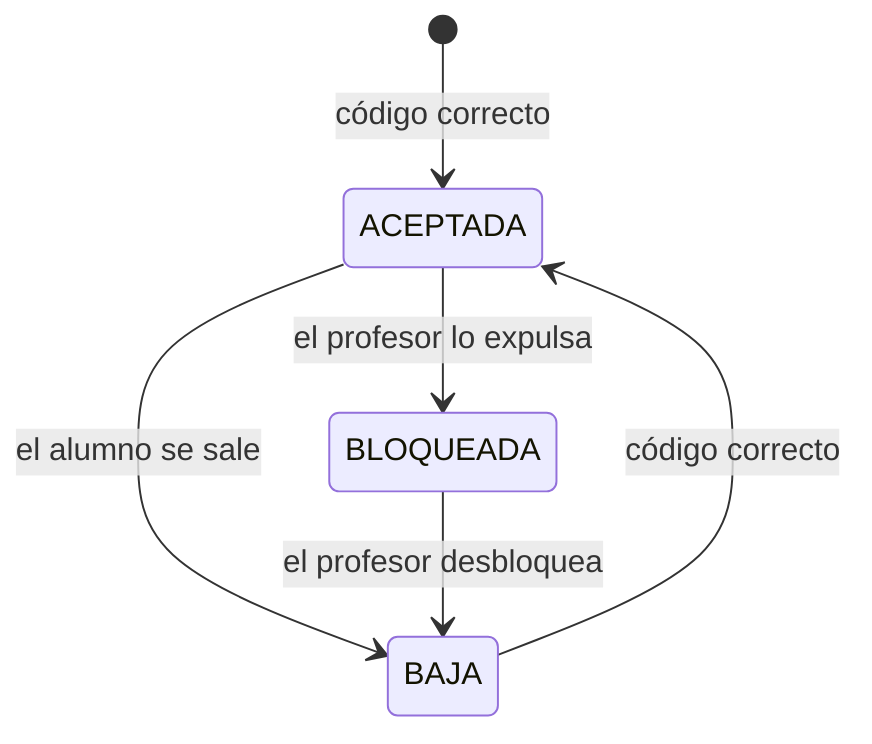

# Datos

Modelo de datos y permisos del MVP. Responsables: Bruno y Adrián. Cualquier cambio se acuerda antes mediante un WI.

## Relaciones

```text
usuarios (profesor) 1──N asignaturas 1──N materiales
                                     1──N actividades 1──N entregas 1──0..1 evaluaciones
usuarios (alumno)   N──N asignaturas  (mediante inscripciones)
usuarios (alumno)   1──N entregas
```

No hay tabla de agenda: se calcula a partir de actividades, entregas y evaluaciones.

## Tablas

Todas usan InnoDB y utf8mb4, con clave primaria `id` autoincremental. Las fechas se guardan en UTC.

### usuarios — tabla `users`

La autenticación utiliza los nombres físicos heredados de Listo.
Las referencias a «usuarios» en este documento corresponden a `users`.

| Campo | Regla |
| --- | --- |
| id | Clave primaria autoincremental |
| name | Texto no vacío, máximo 80 caracteres |
| email | Único, máximo 120 caracteres; sin espacios externos y en minúsculas |
| password_hash | Hash, nunca la contraseña en claro |
| role | `alumno` o `profesor`; obligatorio y por defecto `alumno` |
| created_at | Fecha de creación en UTC |

El registro público permite elegir entre alumno y profesor.
El servidor rechaza cualquier otro valor de rol.

### asignaturas

| Campo | Regla |
| --- | --- |
| codigo | Único, no vacío |
| nombre, descripcion | No vacíos; la descripción es pública |
| curso_academico | Formato `2026-2027` |
| profesor_id | Profesor principal (quien la crea), con rol `PROFESOR` |
| creado_en | Fecha |

Para repetir una asignatura otro curso se crea otra con otro código.

### inscripciones

| Campo | Regla |
| --- | --- |
| asignatura_id, alumno_id | Únicos como pareja; el alumno tiene rol `ALUMNO` |
| estado | `ACEPTADA`, `BAJA` o `BLOQUEADA` |

Los cambios de estado siguen la máquina de estados de «Estados derivados». Las fechas de la inscripción se definirán con el modelo (tarea 1).

### materiales

| Campo | Regla |
| --- | --- |
| asignatura_id | Asignatura a la que pertenece |
| titulo, contenido | Obligatorios, texto plano |
| enlace | Opcional, solo HTTP o HTTPS |
| creado_en, actualizado_en | Fechas |

### actividades

| Campo | Regla |
| --- | --- |
| asignatura_id | No cambia tras crearla |
| titulo, instrucciones | Obligatorios |
| fecha_limite | Futura al crear o editar |
| creado_en, actualizado_en | Fechas |

Con alguna entrega, no se puede editar ni eliminar.

### entregas

| Campo | Regla |
| --- | --- |
| actividad_id, alumno_id | Únicos como pareja |
| contenido | Texto no vacío, máximo 10 000 caracteres |
| entregada_en | Primera entrega |
| actualizada_en | Última edición |

Sin borrado ni historial de versiones.

### evaluaciones

| Campo | Regla |
| --- | --- |
| entrega_id | Único (como máximo una evaluación por entrega) |
| nota | Decimal entre 0.00 y 10.00 |
| comentario | No vacío |
| evaluada_en | Primera evaluación |
| actualizada_en | Última corrección |

El profesor autorizado se deduce de la asignatura; no se guarda.

## Integridad

- Claves foráneas con borrado restringido: nunca se borra trabajo académico en cascada.
- Las restricciones `UNIQUE` evitan duplicados aunque lleguen dos peticiones a la vez.
- Reglas entre tablas (por ejemplo, que el usuario sea profesor) se comprueban en los servicios.
- No se copian nombres, notas ni fechas en otras tablas.
- Índices recomendados: `asignaturas.profesor_id`, `inscripciones(alumno_id, estado)`, `actividades(asignatura_id, fecha_limite)`, `materiales.asignatura_id`, `entregas.actividad_id`.

## Permisos

| Operación | Visitante | Alumno | Profesor |
| --- | --- | --- | --- |
| Ver catálogo y descripción | Sí | Sí | Sí |
| Crear asignatura | No | No | Sí (queda como principal) |
| Editar asignatura | No | No | Si es su profesor (principal o coprofesor) |
| Entrar con el código de matrícula | No | Para sí mismo | No |
| Expulsar o desbloquear a un alumno | No | No | Si es su profesor |
| Darse de baja | No | Solo la propia, si está aceptado | No |
| Ver o regenerar el código de matrícula | No | No | Si es su profesor |
| Invitar o quitar coprofesores, transferir la asignatura | No | No | Solo el principal |
| Aceptar una invitación de coprofesor | No | No | Solo la suya |
| Ver materiales y actividades | No | Si está aceptado | Si es su profesor |
| Publicar o modificar materiales | No | No | Solo en su asignatura |
| Crear actividad | No | No | Solo en su asignatura |
| Editar o eliminar actividad | No | No | Solo propia y sin entregas |
| Entregar o editar trabajo | No | Solo propio, aceptado y antes del cierre | No |
| Ver una entrega | No | Solo propia | Si es de su asignatura |
| Evaluar | No | No | Su asignatura y desde el cierre |
| Ver notas | No | Solo propias | Solo de su asignatura |
| Consultar agenda | No | Sus asignaturas aceptadas | Sus asignaturas |

«Su asignatura» o «su profesor» incluye al principal y a los coprofesores.

El permiso se calcula a partir del recurso real, no del `asignatura_id` ni del rol que llegue en el formulario.

## Estados derivados

**Inscripción:** no existe → código correcto → `ACEPTADA`. Desde `ACEPTADA`: el alumno se sale → `BAJA`, o el profesor lo expulsa → `BLOQUEADA`. Desde `BAJA`: código correcto → `ACEPTADA`. Desde `BLOQUEADA`: el profesor desbloquea → `BAJA`. Volver a entrar reutiliza la misma fila.



**Intentos de código:** 5 fallos en 15 minutos impiden probar durante 15 minutos. Los fallos se reinician al acertar o al acabar el bloqueo. No cambian el estado de la inscripción y se guardan aparte.

**Actividad para un alumno** (en este orden; no se guarda en la base):

| Condición | Estado |
| --- | --- |
| Entrega con evaluación | Evaluada |
| Entrega sin evaluación | Entregada · pendiente de evaluación |
| Sin entrega y antes del cierre | Pendiente |
| Sin entrega y desde el cierre | Vencida sin entrega |

**Cierre** (T = `fecha_limite`): se entrega o edita solo si ahora < T; se evalúa si ahora ≥ T. No hay entregas tardías.

## Concurrencia

- Entregar: bloquear la actividad, comprobar usuario, inscripción y plazo, crear o editar la entrega y confirmar.
- Editar o eliminar una actividad: bloquear la misma fila antes de comprobar que no hay entregas.
- Evaluar: bloquear la actividad y luego la entrega, comprobar profesor y cierre, y guardar la evaluación.
- Cambiar el estado de una inscripción: bloquear su fila y comprobar que el cambio es válido desde el estado actual.
- Entrar con el código: como la pareja alumno y asignatura es única, dos peticiones a la vez no crean dos inscripciones. Los fallos se cuentan bloqueando antes los intentos del alumno en esa asignatura.

Si una operación necesita varios recursos, se bloquean siempre en este orden: actividad, entrega, evaluación.

## Datos de demostración

El escenario completo previsto incluye dos profesores, tres alumnos
y dos asignaturas, con inscripciones aceptadas, de baja y bloqueadas.
También incluye una actividad abierta y otra cerrada, con dos entregas
anteriores al cierre: una evaluada y otra sin evaluar.

Actualmente, `flask seed-db` crea únicamente los dos profesores y
los tres alumnos. El resto del escenario se incorporará al implementar
las features correspondientes.

Las cuentas son ficticias y utilizan la contraseña pública `Prueba1234`,
exclusivamente para desarrollo y demostración. En la base de datos
solo se almacena su hash.